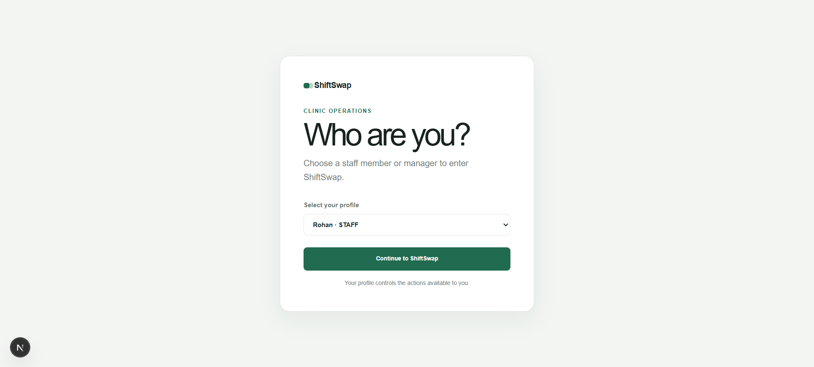
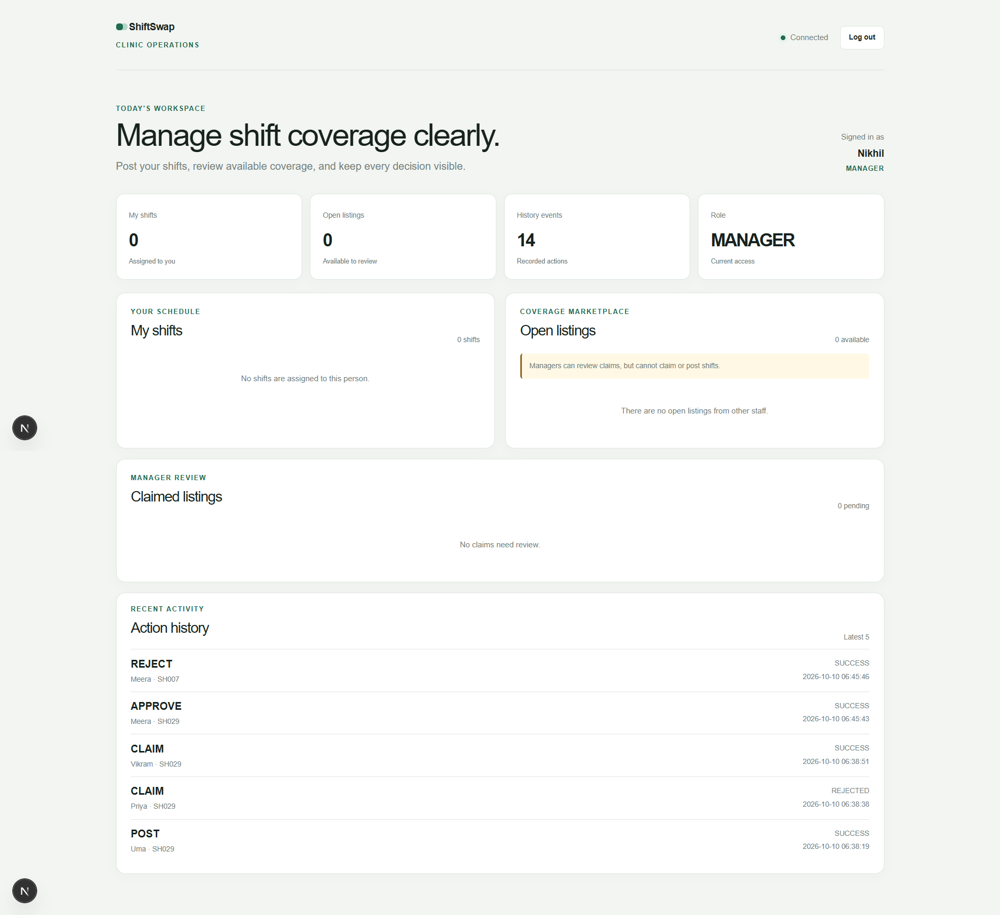

# ShiftSwap

ShiftSwap is a clinic shift-swapping demo. Staff can post an assigned shift,
claim another staff member's open listing, and unclaim it before manager
approval. Managers can approve or reject claimed listings. Every attempted
action is recorded in SQLite history.

## Architecture

- `app/`: Next.js JavaScript frontend.
- `app/lib/api.js`: the only frontend HTTP client; business rules stay in the
  backend.
- `backend/app/main.py`: FastAPI application factory and HTTP routes.
- `backend/app/service.py`: transactional post, withdraw, claim, unclaim,
  approve, and reject operations.
- `backend/app/rules.py`: certification, overlap, rest, and weekly-hour rules.
- `backend/app/database.py`: SQLite schema, seed loading, persistence, and
  serialization.
- `backend/app/SHiftSwap_seed.json`: supplied seed data. It is read-only input
  and is never rewritten by the application.

The frontend uses HTTP requests to the backend. The backend stores staff,
shifts, listings, and action history in
`backend/data/shiftswap.sqlite3`.

## Requirements

- Windows PowerShell
- Node.js and npm
- Python 3.12 or later

## Exact local setup and run commands

Open two PowerShell terminals from the `discover-dollar` directory.

### Terminal 1: backend

```powershell
cd .\backend
py -3.12 -m venv .venv
.\.venv\Scripts\Activate.ps1
python -m pip install -r .\requirements.txt
python -m uvicorn app.main:app --reload --host 127.0.0.1 --port 8000
```

Backend URLs:

- Health: <http://127.0.0.1:8000/health>
- API docs: <http://127.0.0.1:8000/docs>

### Terminal 2: frontend

```powershell
npm install
$env:NEXT_PUBLIC_API_URL = "http://127.0.0.1:8000"
npm run dev
```

Open <http://localhost:3000>.

If the frontend is configured for `http://localhost:8000`, use the default
frontend URL instead. The backend CORS setting accepts the configured
`FRONTEND_URL`, defaulting to `http://localhost:3000`.

## Tests and checks

Backend tests:

```powershell
cd .\backend
.\.venv\Scripts\Activate.ps1
python -m pip install -r .\requirements-dev.txt
python -m pytest .\tests -q
```

Frontend checks:

```powershell
cd ..
npm run lint
npm run build
```

## Persistence and seed assumptions

On first startup, the backend creates the SQLite schema and loads the supplied
seed only when the staff, shifts, listings, and action-history tables contain
no saved application state. Restarting the backend does not reseed or overwrite
listings, assignments, or history.

The repository also contains `discover-dollar/backend/app/shiftswap_backup.sqlite3`,
an initial SQLite backup. If the primary database is new or empty and
`SHiftSwap_seed.json` is unavailable, the backend restores this backup instead
of failing. Existing saved state always takes priority.

The seed currently contains 10 people, including 8 staff and 2 managers, and
61 shifts. Managers cannot post or claim shifts.

## Business rules

Claims are rejected with every applicable reason when the listing is `OPEN`:

1. The claimer must differ from the shift owner.
2. The claimer must have the required certification.
3. Assigned shifts must not overlap.
4. Consecutive non-overlapping assigned shifts must have at least 11 hours
   between them; exactly 11 hours is allowed.
5. Assigned hours in the week containing the target shift's start must not
   exceed 40 hours.

Overnight shifts belong to the week containing their start. Pending claims do
not count as assignments. If a listing is not open, claim returns only
`no longer available`. Manager approval revalidates rules 2–5 against current
assignments and leaves an invalid listing in `CLAIMED`.

## API endpoints

Read:

- `GET /api/health`
- `GET /api/staff`
- `GET /api/shifts`
- `GET /api/listings`
- `GET /api/history`

Actions accept JSON such as `{"actor_id":"S1"}`:

- `POST /api/shifts/{shift_id}/listings`
- `POST /api/listings/{listing_id}/withdraw`
- `POST /api/listings/{listing_id}/claim`
- `POST /api/listings/{listing_id}/unclaim`
- `POST /api/listings/{listing_id}/approve`
- `POST /api/listings/{listing_id}/reject`

Domain failures return a useful `detail` and, where applicable, a `reasons`
array containing rule names, messages, and conflicting shift IDs.

## Screenshots

### Profile selection

Users choose the staff member or manager they are acting as before entering
ShiftSwap.



### Staff dashboard

Staff can view assigned shifts, post shifts for swapping, and review recent
activity.


### Manager dashboard

Managers can review claimed listings and approve or reject requests.



## Known limitations

- The profile selector is a demo identity switch, not authentication.
- Claim eligibility is validated when Claim is submitted; the frontend does not
  reimplement backend rules locally.
- The application does not deploy or provision infrastructure.
- The SQLite file is local development storage and is ignored by Git.
